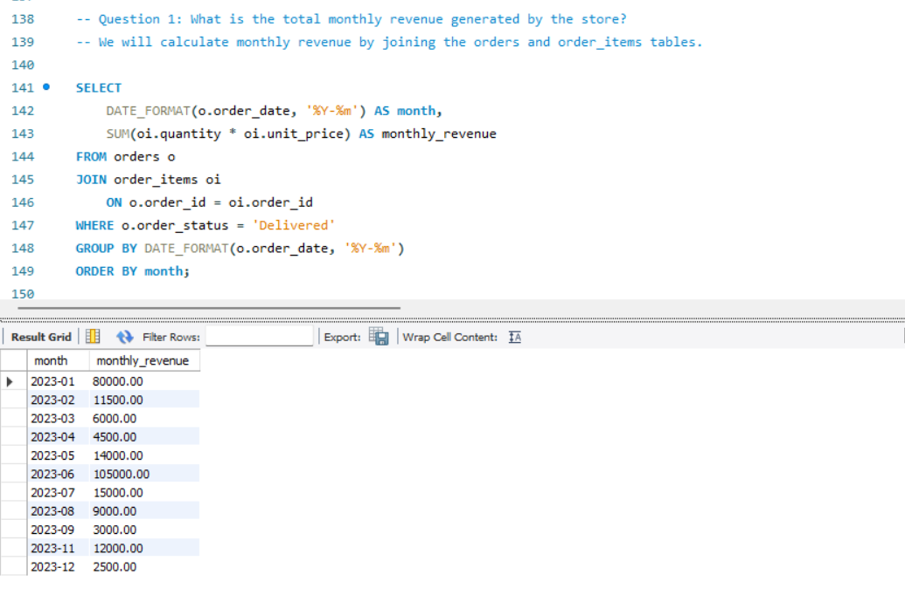
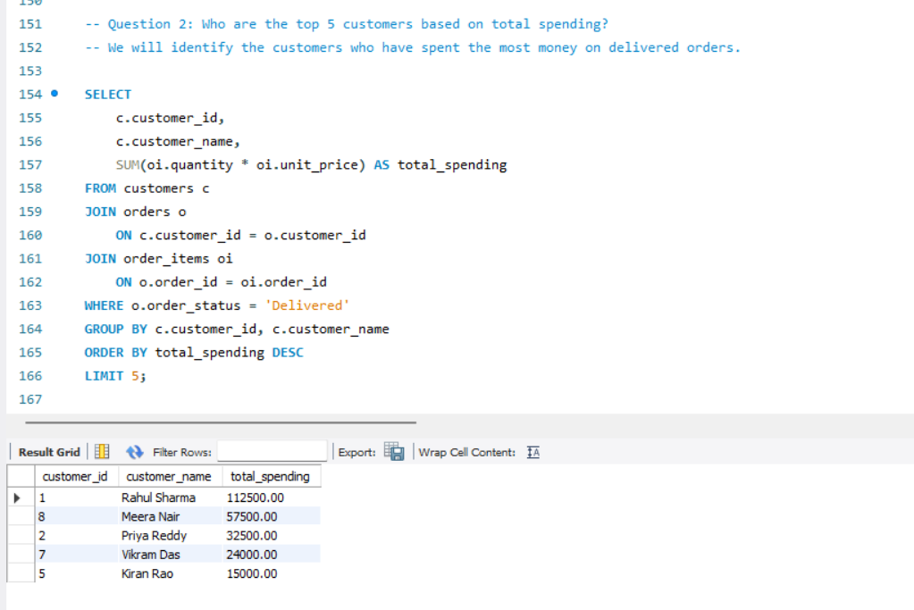
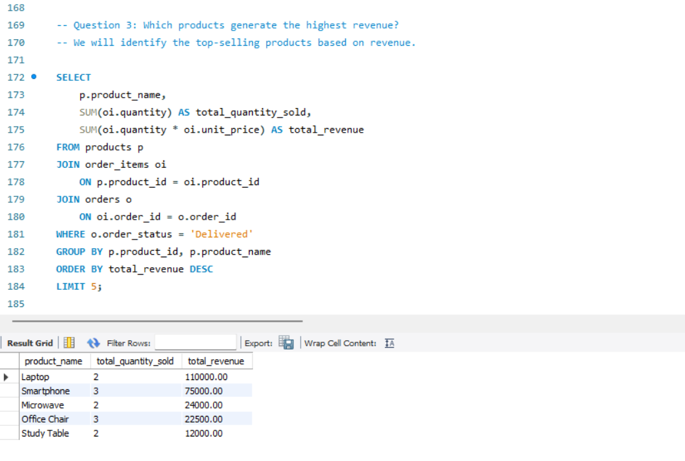
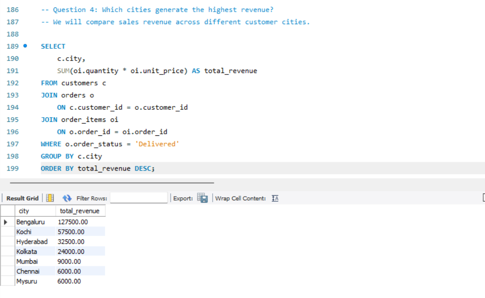
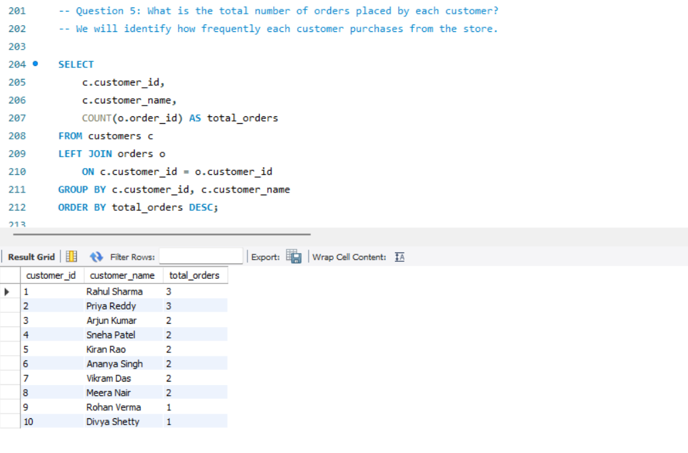
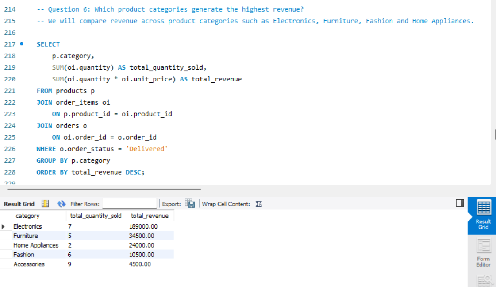
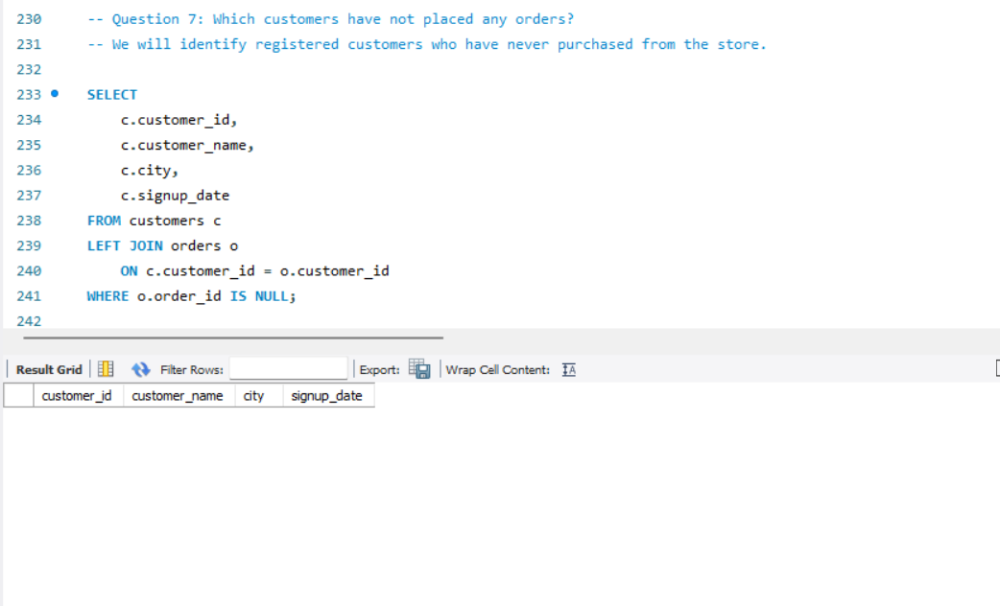
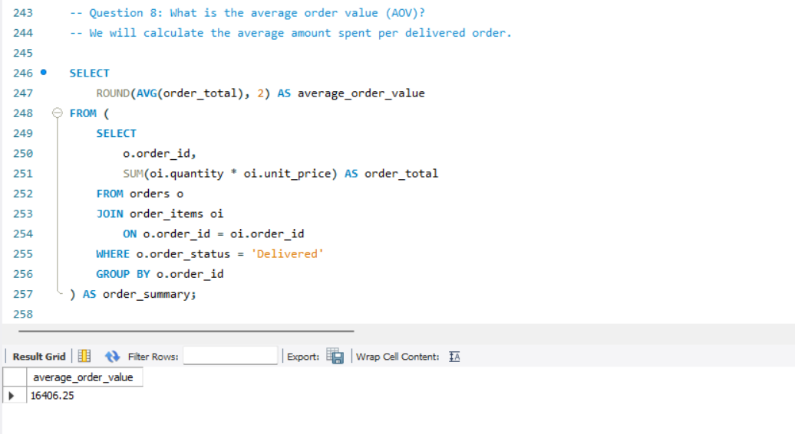
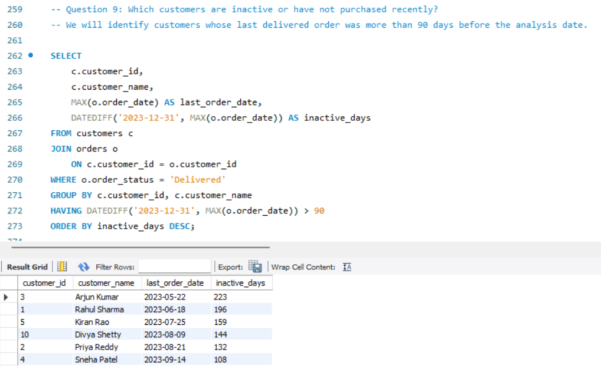
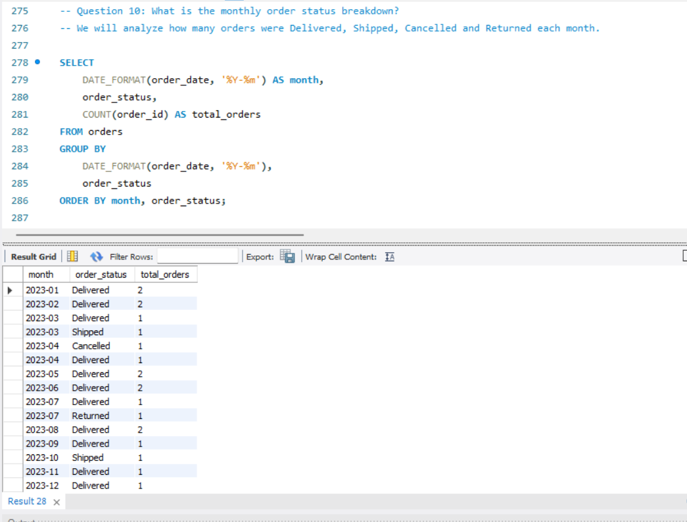

# SQL Business Analysis – NEXLEVR Intermediate Task 3

## Project Overview
This project uses SQL to analyze a sample store database and answer 10 important business questions related to sales, customers, products and order performance.

## Tools Used
- MySQL
- MySQL Workbench
- SQL

## Database Structure
The project contains four tables:
1. Customers
2. Products
3. Orders
4. Order Items

## Business Questions
1. Monthly Revenue Analysis
2. Top 5 Customers by Spending
3. Top 5 Products by Revenue
4. City-wise Revenue Analysis
5. Total Orders per Customer
6. Revenue by Product Category
7. Customers Without Orders
8. Average Order Value
9. Inactive Customer Analysis
10. Monthly Order Status Analysis

## SQL Concepts Used
- SELECT and WHERE
- INNER JOIN and LEFT JOIN
- GROUP BY and ORDER BY
- Aggregate Functions (SUM, COUNT, AVG, MAX)
- HAVING
- Subqueries
- DATE_FORMAT and DATEDIFF
- LIMIT

## Project Objective
To develop SQL querying skills and understand how businesses use data to analyze revenue, customer behavior, product performance and operational activities.

## Deliverables
- SQL database and tables
- Sample store dataset
- 10 SQL business queries
- Query explanations and business insights

## Author
Neeraj J.

## Query Results

### 1. Monthly Revenue Analysis

### 2. Top 5 Customers by Spending

### 3. Top 5 Products by Revenue

### 4. City-wise Revenue Analysis

### 5. Total Orders per Customer

### 6. Revenue by Product Category

### 7. Customers Without Orders

### 8. Average Order Value

### 9. Inactive Customer Analysis

### 10. Monthly Order Status Analysis

